<picture>
<source media="(prefers-color-scheme: dark)" srcset="assets/banner-dark.svg">

</picture>

I'm an iOS developer working on eKYC and face authentication. I've also built mobile banking and photo editing apps, and optimized multithreaded code for performance. Most of my side projects start from the same question: what are Swift and UIKit actually doing at runtime? Then I build tools around the answer.

### Projects

| Project | What it does |
| --- | --- |
| **[TLeakDetector](https://github.com/Jelly12T/TLeakDetector)** | Debug-only leak detector for UIKit. When a screen closes but isn't freed, it reports the retain cycle or the owner holding it (Task, Timer, observer…) and suggests the exact fix. Nothing ships in Release. |
| **[Demo-Vcam](https://github.com/Jelly12T/Demo-Vcam)** | AVFoundation test bench that compares a live camera feed with an injected video feed, plus a detector that tells them apart. The defensive side of virtual-camera attacks on eKYC. |
| **[MyBudget](https://github.com/Jelly12T/MyBudget-)** | Personal finance app in SwiftUI with a Vietnamese UI. |

### Stack

<picture>
<source media="(prefers-color-scheme: dark)" srcset="https://skillicons.dev/icons?i=swift%2Ccpp%2Cpy%2Cgo%2Cgit%2Cgitlab%2Cjenkins&theme=dark">

</picture>

Swift and Objective-C on iOS: SwiftUI, UIKit, Combine, Swift Concurrency, AVFoundation. Strong background in algorithms and data structures, mostly in C++ and Python. Go on the backend, and GitLab + Jenkins CI on macOS runners.

### LeetCode

<a href="https://leetcode.com/u/jelly12T/">
<picture>
  <source media="(prefers-color-scheme: dark)" srcset="https://leetcard.jacoblin.cool/jelly12T?theme=dark">
  
</picture>
</a>

### Contact

[lehoangthach12.work@gmail.com](mailto:lehoangthach12.work@gmail.com) or [LinkedIn](https://www.linkedin.com/in/th%E1%BA%A1ch-l%C3%AA-379345231/)
